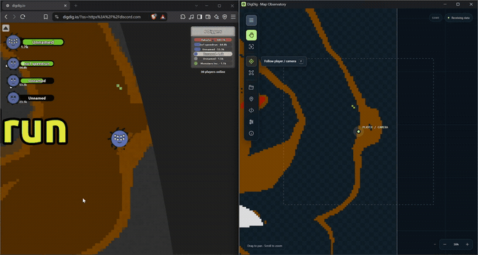
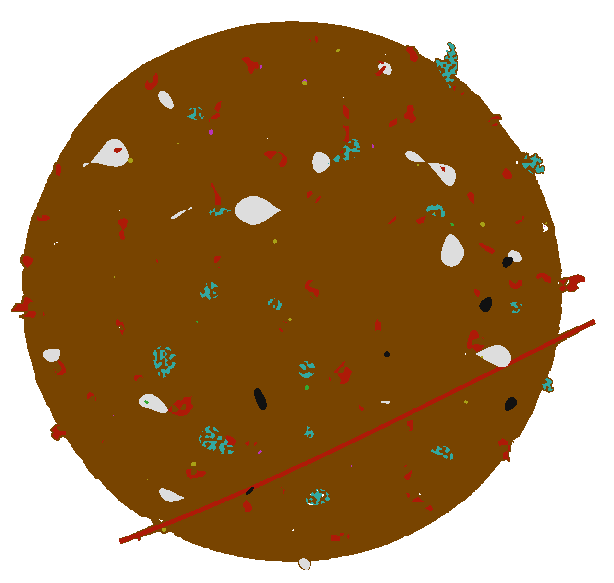

# DigDig.IO Tools

> This is a monorepo containing packages and tools developed for the [DigDig.IO](https://digdig.io/) game. This repository is **not affiliated with the official DigDig.IO game or its developers**. These tools are intended for fun and experimental purposes only. They are not designed for, nor should they be used in, any form of cheating. They do not alter the game's logic or mechanics, change player controls, or automate play. The scanner reads game memory and observes terrain drawing calls; it does not write to game memory or modify the game's WASM instructions.

<div align="center">

## Explore the world. Keep the map.

**Map Observatory** turns your exploration into a live desktop map.<br />
Watch nearby terrain take shape, mark places to revisit, and keep your discoveries in a map of your own.


[](LICENSE)

**[Get started](#get-started)** · **[Try an example map](#try-an-example-map)** · **[Build from source](#build-and-deploy)** · **[Development guide](docs/DEVELOPMENT.md)**



*Your game on the left. Your growing map on the right.*

</div>

## A map you can explore, edit, and keep

| Feature | What you can do |
| --- | --- |
| **Watch your scan grow** | Collect nearby dirt, quartz, diamond, bedrock, gold, amethyst, uranium, and lava. Keep recorded discoveries visible when fog returns. |
| **See where you are** | Follow the player/camera, zoom without losing Follow, or fit the current boundary and all captured chunks into view. |
| **Make it your atlas** | Right-click to add named markers. Keep a list of places to revisit and show or hide your notes. |
| **Clean up your scan** | Select individual chunks or drag a selection, then remove chunks and markers from the context menu. |
| **Save, combine, and share** | Save `.chunks`, merge saved discoveries into a live scan, preview a map separately, or export an uncompressed PNG with the original terrain pixels. |
| **Keep it beside the game** | Use a compact canvas, an icon menu, Always on top, and whole-window opacity from **20% to 100%**. |

Choose capture intervals from **20 ms to 1 second** in Settings; **100 ms** is the default. The interval is a target, with actual updates depending on browser scheduling and game rendering.

## Try an example map

Start with a real **289-chunk scan**. Download the `.chunks` file, open Map Observatory, and choose **☰ → Files → Preview .chunks**. You can pan, zoom, and inspect the saved terrain without a running game or an installed userscript.

<p align="center">
  <a href="docs/assets/explored-map.png">
    
  </a>
</p>

<p align="center">
  <a href="examples/digdig-map.chunks?raw=1"><strong>Download the example .chunks</strong></a>
  · <a href="docs/assets/explored-map.png?raw=1">Download the full-resolution PNG</a>
</p>

The PNG and `.chunks` contain the same terrain. The image is **1280 × 1216 pixels**; the editable scan retains world coordinates and map metadata. [About the example](examples/README.md).

## Get started

You need **Windows x64**, a browser with [Tampermonkey](https://www.tampermonkey.net/), and the [Microsoft Edge WebView2 Runtime](https://developer.microsoft.com/microsoft-edge/webview2/). Firefox and Brave have been tested with this project. The packaged app includes its userscript and local bridge; no Node.js, npm, or Rust installation is needed to run it.

1. **Get the desktop app.** Open [Releases](https://github.com/Flammrock/DigDig.IO-Tools/releases) and choose a **2.x** Windows release. Download and extract its Windows x64 ZIP, then run `DigDig-Map-Observatory.exe`. Releases **1.x** are the previous app; if no 2.x release is published yet, [build this version from source](#build-and-deploy).
2. **Install its userscript.** In the app, open **☰ → Install userscript → Install userscript** and confirm installation in Tampermonkey. The app also offers **Copy to clipboard** and **Export .user.js**.
3. **Enable script execution.** In Brave/Chrome, open the browser's Extensions page, choose **Tampermonkey → Details**, and enable **Allow User Scripts**. Allow the script's connection to `127.0.0.1` if prompted. [Tampermonkey's permission guide](https://www.tampermonkey.net/faq.php?locale=en&q=Q209).
4. **Start exploring.** Keep the app open, reload [digdig.io](https://digdig.io/), enter a round, and move around. The desktop map starts filling as terrain is captured. Use **☰ → Settings** to choose a session or change the update interval.

**Save your scan as `.chunks` before closing the app.** Terrain lives in memory during the session; saving lets you resume or share it later. Keep only one DigDig userscript enabled in each browser.

## Your scanning workflow

**Explore → mark → save → continue.** The app keeps navigation and editing on the canvas, with the tools tucked into the hamburger menu.

- **Pan and follow:** drag to look around, or enable Follow to keep the player/camera centered. Zooming keeps Follow enabled; panning releases it.
- **Mark a place:** right-click with nothing selected, add a marker, and give it a useful name. Find it again in the Markers panel.
- **Continue a scan:** choose **Load .chunks** to merge it into the live map. Current observed pixels take priority; saved data fills unknown areas.
- **Inspect a saved map:** choose **Preview .chunks** for a separate terrain view. A compatible live session can supply its current position and boundary without changing the saved terrain.
- **Share an image:** export PNG for the terrain alone, with transparent unknown areas and no markers or interface overlays. Each source terrain pixel in a verified grid becomes one PNG pixel. View at 100% or use nearest-neighbor zoom to avoid image-viewer smoothing.

<details>
<summary><strong>Keyboard shortcuts</strong></summary>

| Shortcut | Action |
| --- | --- |
| `Ctrl+S` | Save `.chunks` |
| `Ctrl+Shift+S` | Export PNG |
| `Ctrl+O` | Open `.chunks`: merge with an available live session, otherwise preview |
| `Ctrl+A` | Select all chunks and visible markers |
| `Delete` | Delete selected map items |
| `Ctrl+Shift+Delete` | Clear chunks, with confirmation; keep markers |
| `F` | Toggle Follow |
| `Home` | Fit the entire map |
| Hold `Space` | Temporarily pan in Select mode |
| `Escape` | Close a panel/context menu or clear the selection |

In text fields, `Ctrl+A` selects text normally. Shift-click adds or removes individual map items from a selection.

</details>

### A scan records discoveries over time

Captured materials are a history of observations, not a guarantee that an ore is still present. The game boundary changes as the world resizes; older captured pixels can remain outside a smaller boundary. All live game tabs and reloads contribute to one shared scan, so clear it when switching to a different world.

The live game cache holds up to **1,024 chunks**, evicting the oldest observations when full. Save milestones as `.chunks`. Files support up to **2,048 chunks** and **512 markers**. PNG exports retain full resolution and report an error if their size limit is exceeded; they are never silently reduced.

## How it connects

The userscript reads nearby terrain and coordinates, then sends observations through an authenticated **local HTTP bridge**. In the packaged app, that bridge runs inside Tauri on `127.0.0.1:4319`; the canvas viewer receives updates through Tauri IPC. Map capture does not require a separate Node server or a cloud account.

Known game builds use verified memory layouts. For an unfamiliar build, the app can inspect the original WASM bytes, resolve instruction patterns, and validate the result against live observations before capturing. Game updates can still require new support; the scanner waits when it cannot validate a layout.

Settings, pairing data, and the layout cache live in `%LOCALAPPDATA%\io.digdig.tools.viewer\`. Open **☰ → Map information → Open in Explorer** to find the actual folder. Share `.chunks`, PNGs, and the generic release userscript; personalized userscripts contain your installation's pairing credential.

## Build and deploy

For Windows builds, install **Node.js 24**, **npm 11** (the workspace declares **11.9.0**), a stable **Rust MSVC** toolchain, **Microsoft C++ Build Tools** with *Desktop development with C++*, and **WebView2**. Follow the [official Tauri Windows prerequisites](https://v2.tauri.app/start/prerequisites/#windows).

Clone the repository, then build from its root:

```powershell
git clone https://github.com/Flammrock/DigDig.IO-Tools.git
cd DigDig.IO-Tools
npm ci
npm run deploy
```

The build writes a portable app and its companion files to `deploy/`:

```text
deploy/
├── DigDig-Map-Observatory.exe   Desktop app with the userscript embedded
├── digdig.user.js              Generic userscript for distribution
├── README.txt                 Installation and troubleshooting
└── manifest.json              Version, file sizes, and SHA-256 hashes
```

The first Rust build takes longer. Close the deployed EXE before replacing it. `npm run deploy` prepares local distribution files; publishing a GitHub release is handled by the [release workflow](.github/workflows/main.yml).

For ZIP/checksum generation, version management, and release-please setup, see the [release guide](docs/RELEASING.md).

## Develop with live reload

After installing the build prerequisites:

```powershell
npm ci
npm run dev:desktop
```

This starts the userscript watcher and development bridge, then opens Tauri. Frontend edits update through Vite; Rust edits recompile and restart the desktop app.

1. Install the development userscript from **<http://127.0.0.1:4317/install.user.js>**. Disable the production script while using it.
2. Open **<http://127.0.0.1:4317/fixture>** to test capture with synthetic terrain, or reload the game and enter a round.
3. Edit the userscript runtime: Webpack rebuilds it and the installed loader replaces it automatically. Changes to the early bootstrap, observation hooks, metadata, or connection token require reinstalling the development script and reloading the page.

The development bridge uses port **4317**; Vite uses **4318**. `npm run dev` starts only the userscript watcher/bridge. For frontend-only work, run `npm exec -- nx run desktop:web-dev` alongside it.

```powershell
npm run typecheck
npm test
cargo test --locked --manifest-path apps/desktop/src-tauri/Cargo.toml
npm run check:versions
```

Read [AGENTS.md](AGENTS.md) before changing capture or analysis. Original game WASM bytes and instructions must remain unchanged. The [development guide](docs/DEVELOPMENT.md) covers injection timing, diagnostics, data locations, and the workspace layout.

## Troubleshooting

| Symptom | What to check |
| --- | --- |
| Nothing happens in Brave/Chrome | Enable **Allow User Scripts** in Tampermonkey's extension details, then reload the game. |
| The app is waiting for a game | Keep the app open, install the script from that app, reload the game, and enter a round. Confirm the script is enabled and may connect to `127.0.0.1`. |
| Connected, but waiting for WASM capture | The hook must run before the game starts. In Tampermonkey's advanced settings, check **Content Script API**: **UserScripts API** on Firefox, or **UserScripts API Dynamic** on Brave/Chrome. Reload after changing it; see the [injection timing guide](docs/DEVELOPMENT.md#userscript-injection-timing). |
| A generic `.user.js` asks for pairing | With the app running, use Tampermonkey's **DigDig: Pair with desktop** menu and install the personalized replacement. |
| The game updated and capture stopped | Check for a newer release. An unknown build is captured only after its layout can be resolved and validated. |
| The bridge port is occupied | Close another copy of the app. Production uses **4319**; development uses **4317**. |

More help is built into **☰ → Install userscript** and Tampermonkey's **DigDig: Help / troubleshooting** menu. To report a problem, [open an issue](https://github.com/Flammrock/DigDig.IO-Tools/issues) with your app version, browser, and what you expected to see. Keep pairing tokens and personalized scripts private.

## Contribute

This workspace uses **npm + Nx**, with a **Tauri 2 / Rust** desktop host and a **TypeScript / Vite** canvas viewer. Start with the [development guide](docs/DEVELOPMENT.md), run the relevant checks, and describe the behavior your change improves.

Built by [Flammrock](https://github.com/Flammrock) · [MIT license](LICENSE) · [Changelog](CHANGELOG.md)
